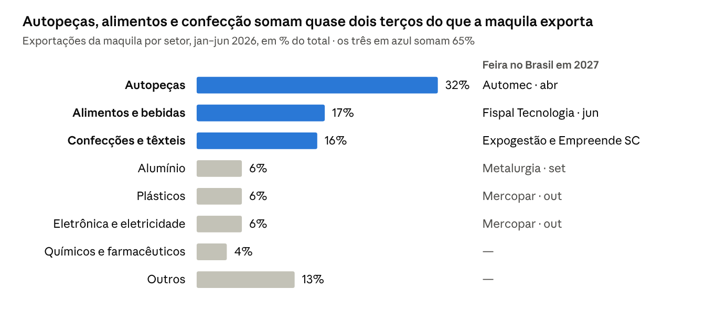
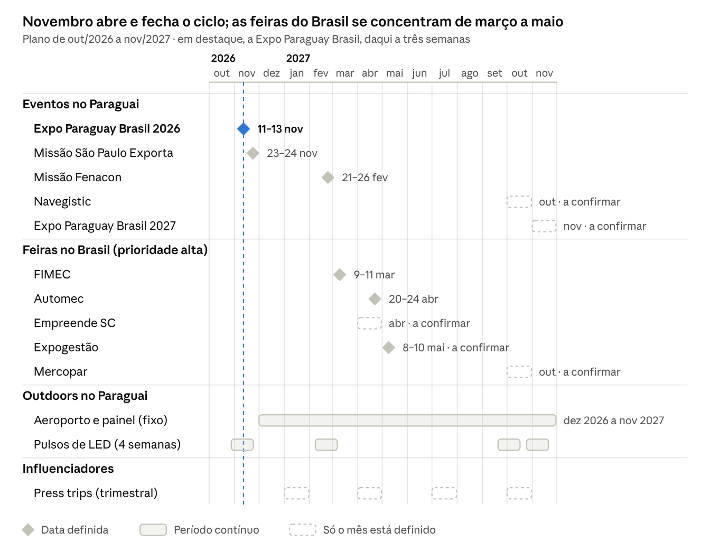

# Bracerum Park — Plano Estratégico de Divulgação

Versão de 21/10/2026. O documento vivo, com comentários e gráficos interativos, está em
<https://claude.ai/artifact/9wdYLJP2gY85kX6TnqoJ7F> — esta cópia é o registro no repositório.

## Estratégia

A verba vai para os quatro lugares onde o industrial brasileiro decide mudar de país: o voo e o caminho até Villeta, o feed de quem ele segue para entender o Paraguai, os eventos de investimento em Assunção e as feiras do próprio setor no Brasil. Todo canal leva a uma única ação: **agendar a visita ao parque**.

**Para quem falamos**

- **O decisor industrial brasileiro** — dono ou diretor de indústria têxtil, calçadista, de plásticos, metalmecânica ou autopeças, sobretudo de SC, PR, RS e SP, que já estuda a maquila por causa do custo no Brasil.
- **O investidor** — family office ou incorporador que procura terreno industrial e imobiliário no Mercosul.
- **Os prescritores** — escritórios de advocacia, contadores, consultorias de instalação e câmaras de comércio que indicam endereço para quem chega. Um prescritor convencido traz vários clientes.

**Mensagem central:** uma cidade industrial pronta em Villeta, sobre a hidrovia e a PY19, com hotel, centro de convenções e resort no mesmo terreno. A prova vem dos números que o site já publica: 1% de tributo único na maquila, 100% de capital estrangeiro, 20 anos de benefícios pela Ley de Inversiones e 10 anos de isenção sobre remessas de dividendos.

**O funil**

1. **Ver** — outdoors no Paraguai e conteúdo de influenciadores criam reconhecimento do nome.
2. **Entender** — vídeo de 60 s, site trilíngue e página de tributação respondem "por que Villeta".
3. **Visitar** — feiras e missões empresariais trazem o decisor ao parque, com transfer do aeroporto e hospedagem.
4. **Fechar** — reunião comercial com proposta de lote.

Cada peça carrega um QR e um link com UTM próprio, para saber que canal trouxe cada visita.

## Outdoors no Paraguai

O outdoor vai no caminho que o empresário estrangeiro faz de fato: desembarque no Silvio Pettirossi, autopista, eixo corporativo de Assunção e PY19 até o parque. O aeroporto passou de 1.285.623 passageiros em 2025, recorde histórico ([Prensa Mercosur](https://prensamercosur.org/2025/12/25/paraguay-alcanza-record-historico-de-pasajeros-en-en-aeropuerto-silvio-pettirossi-durante-el-2025/)), e a maior parte do tráfego é internacional ([ABC](https://www.abc.com.py/nacionales/2024/06/26/interes-en-la-privatizacion-del-aeropuerto-pettirossi/)).

| Prioridade | Ponto | Por que lá | Formato | Quem vende |
| --- | --- | --- | --- | --- |
| 1 | **Aeroporto Silvio Pettirossi** — desembarque, esteira de bagagem, sala VIP | É a porta de entrada de quase todo executivo que vem avaliar o país | Painel ou tela no desembarque; patrocínio da sala VIP | [JCDecaux](https://www.abc.com.py/nacionales/2024/06/13/mensaje-provida-en-el-silvio-pettirossi-desata-oleada-de-criticas/), segundo a DINAC (2024) — confirmar contrato vigente |
| 2 | **Autopista Silvio Pettirossi**, saída do aeroporto | Primeira imagem do país a caminho do hotel | Tela LED "Aeropuerto Autopista", 9,12 × 9,60 m, cerca de 40.000 veículos/dia | [JWF Group](https://jwf.com.py/ooh-media/) |
| 3 | **Aviadores del Chaco × San Martín**, distrito financeiro | Bancos, escritórios de advocacia e hotéis de negócios: os prescritores trabalham ali | Tela LED curva de 14 × 7 m, o "Time Square asunceno" | [RH Rodríguez Hnos.](https://infonegocios.com.py/y-ademas/rh-lanza-pantalla-led-curva-de-ultima-generacion-para-publicidad-exterior-en-asuncion) |
| 4 | **Santa Teresa e Delsol**, eixo de shoppings e hotéis | Maior fluxo da cidade, cerca de 95.000 veículos/dia cada | Telas LED de 20 × 28,5 m e 23 × 20 m | [JWF Group](https://jwf.com.py/ooh-media/) |
| 5 | **Acceso Sur e PY19 até Villeta** | Quem vai ao Terport e ao Puerto Seguro passa na porta do parque | Painel e totem **no próprio terreno**, com "Você está chegando" | Produção própria |
| 6 | **Ciudad del Este**, Ponte da Amizade e Aeroporto Guaraní | Fronteira com o Brasil e sede da Expo Paraguay Brasil em novembro | LED em terreno privado com licença | [MG Pro](https://infonegocios.com.py/default/del-cartel-al-led-como-esta-cambiando-el-negocio-de-la-publicidad-exterior-en-el-pais), entre outros |

**Por que painel próprio na PY19:** o MOPC não autoriza placas na faixa de domínio das rotas nacionais (art. 43 da Lei 5.016/2014) e mandou retirar as irregulares em maio de 2026 ([La Nación](https://www.lanacion.com.py/pais/2026/05/29/el-mopc-recuerda-que-no-autoriza-la-instalacion-de-carteles-en-la-franja-de-dominio/)). Na frente do próprio lote o risco some.

**Como comprar:**

- **Fixo o ano todo:** aeroporto (1) e painel do parque (5). São os dois pontos que o decisor vê na ida e na volta da visita.
- **Em pulsos de 4 semanas nas telas LED (2, 3, 4, 6):** antes e durante cada evento do calendário, quando há mais empresários estrangeiros na cidade. LED permite trocar a peça sem reimprimir.
- **Idioma por lugar:** português no desembarque e em Ciudad del Este, onde o público é o brasileiro que chega; espanhol nas telas de Assunção, onde estão os prescritores.
- **Peça:** uma frase de até 7 palavras, um render do parque e o QR da visita. Paleta do site (preto, branco, bege), sem vermelho.

Nenhuma das empresas publica tabela de preços: pedir cotação por ponto e por período à JCDecaux, JWF, RH e MG Pro.

## Influenciadores

Em B2B a influência que move uma fábrica vem de quem o empresário já consulta antes de decidir: criadores que vivem e empreendem no Paraguai, mídia de negócios e os prescritores. O formato que funciona é a **visita gravada ao parque**, não o post patrocinado avulso.

**Filtro obrigatório antes de contratar.** Boa parte do conteúdo "mude-se para o Paraguai" no Brasil é partidário ou exagera. Em setembro de 2026 o El Surti mapeou perfis ligados à agência Imigra Paraguai e ao portal Conexão Política ([Mídia NINJA](https://midianinja.org/opiniao/paraguai-o-eden-dos-conservadores-brasileiros/)), e a Aos Fatos desmentiu o post viral das "232 empresas que fugiram" ([Aos Fatos](https://www.aosfatos.org/noticias/falso-232-empresas-paraguai-governo-lula/)). O Bracerum vende para industriais de qualquer orientação. Regra: nenhum criador com pauta partidária, nenhuma promessa fácil, todo número conferido com o jurídico.

| Camada | Nome | Canal e alcance | Como usar |
| --- | --- | --- | --- |
| Criador brasileiro no PY | [Valor Paraguay — Marlon Rihayem](https://vidiq.com/youtube-stats/channel/@romper.global/) | YouTube, cerca de 145 mil inscritos e 4,4 milhões de views (estimativa vidIQ); custo de vida, negócios, mitos sobre o PY | Episódio longo gravado no parque + cortes para Reels e Shorts |
| Podcast de negócios | [Contra o Vento](https://open.spotify.com/episode/5eLlrynJJkdJC5oE74MGRm) | Já fez episódio "Lei Maquila: como levar sua indústria para o Paraguai" | Diretor comercial como convidado |
| Podcast de negócios | [Podcast Inbix](https://podcasts.apple.com/us/podcast/podcast-inbix/id1711399530) | Episódio de fev/2025 "Por que empreender no Paraguai agora?", com diretores da Bazacon e da Proinlab | Convidado + cliente âncora |
| Voz de negócios paraguaia | [Gloria Ayala Person](https://www.lanacion.com.py/negocios/2026/06/07/gloria-ayala-person-el-mercado-de-capitales-no-es-una-opcion-lejana-es-una-herramienta-de-desarrollo/) | Economista, ex-gerente da Bolsa de Assunção; 108,5 mil seguidores no Instagram ([HypeAuditor](https://hypeauditor.com/top-instagram-business-careers-paraguay/)) | Conteúdo sobre investimento industrial e financiamento de lotes, em espanhol |
| Mídia de negócios PY | [Forbes Paraguay](https://hypeauditor.com/top-instagram-business-careers-paraguay/) | 236 mil no Instagram; patrocina o espaço de startups da Expo Paraguay Brasil | Entrevista e conteúdo de marca |
| Mídia de negócios PY | [InfoNegocios](https://infonegocios.com.py/y-ademas/rh-lanza-pantalla-led-curva-de-ultima-generacion-para-publicidad-exterior-en-asuncion) | 65 mil no Instagram; tem formato pago de conteúdo de marca (InfoBrand) | Lançamento do parque e cobertura dos marcos de obra |
| Mídia de negócios BR | [Forbes Brasil](https://forbes.com.br/forbes-money/2026/06/empresas-brasileiras-paraguai-lei-de-maquila/), [CNN Brasil Money](https://www.cnnbrasil.com.br/economia/money/macroeconomia/paraguai-e-foco-de-empresas-brasileiras-que-buscam-produzir-com-menor-custo/), [Gazeta do Povo — Paraná S.A.](https://www.gazetadopovo.com.br/vozes/parana-sa/produzir-no-paraguai/) | Todos publicaram matéria sobre indústria brasileira no PY em 2026 | Assessoria de imprensa: pauta "a cidade industrial que nasce em Villeta" |
| Prescritores | Câmara de Comércio Paraguay Brasil, CEMAP, Rediex e [Fenacon](https://fenacon.org.br/?p=55555) | LinkedIn e eventos próprios | Webinars co-assinados e visitas de grupo |

**Formatos, em ordem de prioridade:**

1. **Press trip trimestral** — 3 ou 4 criadores e jornalistas por vez, com transfer do aeroporto, hotel e entrevista com a engenharia. Sai uma peça longa por criador e cortes para as redes.
2. **Série "Quanto custa produzir em Villeta"** — episódios curtos com um tributarista, usando os números já publicados no site.
3. **Voz própria no LinkedIn** — o diretor comercial publica duas vezes por semana; é onde os prescritores estão.

No contrato: identificação de publicidade (#publi), revisão jurídica de qualquer número tributário e direito de uso do material nas feiras.

## Feiras e eventos no Paraguai

O evento central é a **Expo Paraguay Brasil + Paraguay Business Week**, daqui a três semanas (11 a 13 de novembro de 2026) e de novo em novembro de 2027: é onde o MIC, a Rediex, a CEMAP e a Câmara de Comércio Paraguay Brasil reúnem o empresário brasileiro que procura o país. Em segundo lugar vêm as missões empresariais que já trazem grupos prontos a Assunção — basta pedir um dia da agenda para a visita ao parque.

| Quando | Evento | Onde | Público | O que o Bracerum faz | Prioridade |
| --- | --- | --- | --- | --- | --- |
| 11–13 nov 2026 | [Expo Paraguay Brasil, 17ª ed.](https://www.expoparaguaybrasil.com/), dentro da Paraguay Business Week | Centro TASK, Parque Tecnológico Itaipu, Hernandarias | 12.000 visitantes previstos; a rodada de 2025 fechou US$ 420 milhões em acordos ([InfoNegocios](https://infonegocios.com.py/y-ademas/paraguay-business-week-y-expo-paraguay-brasil-2026-12-000-visitantes-y-mas-de-300-stands-en-ciudad-del-este)) | Equipe comercial na rodada de negócios, pulso de LED em Ciudad del Este, convite para visita a Villeta. O prazo de expositor brasileiro fechou em 20/set ([Apex](https://click.apexbrasil.com.br/mkt/2026/Regulamento%20Geral%20de%20Participa%C3%A7%C3%A3o_Expo%20Paraguay%20Brasil%202026_vf.pdf)) | Alta — agora |
| 23–24 nov 2026 | [Missão São Paulo Exporta](https://investsp.org.br/uploads/documentos/saopaulo-exporta/20260828_regulamento_missao_saopauloexporta_prco.pdf) (FIESP, InvestSP, Sebrae SP) | Assunção | Até 30 empresas paulistas de alimentos, pet e cosméticos | Oferecer o parque como visita técnica do dia 23 | Média |
| 21–26 fev 2027 | [Missão Fenacon](https://fenacon.org.br/?p=55555) | Assunção e Ciudad del Este | 50 empresários da contabilidade — prescritores | Visita guiada com almoço e kit técnico para levarem aos clientes | Alta |
| mar 2027 | [INNOVAR](https://innovar.com.py/) (2026: 17–20 mar) | Cetapar, Yguazú, Alto Paraná | Agronegócio e máquinas | Só se houver lote voltado a agroindústria | Baixa |
| mai 2027 | [Constructecnia](https://www.gpee.com.py/constructecnia) (2026: 21–24 mai) | Centro de convenções da Conmebol, Luque | Construtoras, materiais, infraestrutura | Apresentar o empreendimento e atrair construtoras para as obras dos lotes | Média |
| jun 2027 | [Expo Logística Paraguay](https://marketcomunicaciones.com/) | Assunção / Luque | Operadores logísticos e de transporte | Palestra sobre hidrovia + PY19 e o parque como base logística | Média-alta |
| jul 2027 | [Expo Paraguay](https://expopy.com.py/) (2026: 11–26 jul) | Parque da ARP, Mariano Roque Alonso | Maior feira multissetorial do país, muito público geral | Presença na rodada de negócios, sem estande grande | Média |
| out 2027 | [Navegistic](https://navegistic.com/py/es/) (2026: 6–8 out) | Paseo La Galería, Assunção | Logística, portos e navegação | Patrocínio e palestra: Villeta é o polo dos terminais privados | Alta |
| out 2027 | [FITPAR](https://fitpar.org.py/) | Centro de Convenciones Mariscal, Assunção | Turismo e eventos | Vender o Centro de Convenções e o hotel como sede de congressos | Média |
| nov 2027 | Expo Paraguay Brasil, 18ª ed. / Paraguay Business Week | A confirmar | Igual a 2026 | **Estande próprio** — reservar com a CCPB no 1º semestre, antes de o espaço esgotar | Alta |

Datas de 2027 marcadas só com o mês seguem o ciclo de 2026 ([calendário da ICE](https://www.ice.it/it/sites/default/files/inline-files/FIERE_IN_PARAGUAY_2026.pdf)) e precisam ser confirmadas com os organizadores.

**Evento próprio:** um *Bracerum Day* por semestre — café da manhã em Assunção com prescritores e transfer até Villeta — colado à Expo Paraguay Brasil e à Navegistic, quando a cidade está cheia de empresários de fora.

## Feiras no Brasil

No Brasil a regra é ir aonde está o **próximo cliente**: as feiras dos setores que já produzem pela maquila e os encontros de gestão do Sul, onde estão os donos das indústrias. Autopeças, alimentos e confecção somam 65% do que a maquila exportou no 1º semestre de 2026 (US$ 717 milhões, +25%), e 62% foi para o Brasil ([MIC, jun/2026](https://www.mic.gov.py/wp-content/uploads/2026/07/Informe-MAQUILA-junio2026-VSAjustada.pdf)).

| Quando | Feira | Onde | Por que lá | Formato | Prioridade |
| --- | --- | --- | --- | --- | --- |
| 1–5 fev 2027 | [Show Rural Coopavel](https://www.canalrural.com.br/agricultura/show-rural-coopavel-teve-recorde-de-publico-e-r-75-bilhoes-em-negocios/) | Cascavel (PR), BR-277 | 430 mil visitantes em 2026; agroindústria e transporte do oeste do Paraná, a caminho da fronteira | Estande compacto ou presença no espaço da Rediex | Média |
| 9–11 mar 2027 | [FIMEC, 50ª ed.](https://www.worldfootwear.com/events/fimec-brazil-mar-9-2027/5755.html) | Fenac, Novo Hamburgo (RS) | Calçado e componentes: a Folha aponta o calçado como o setor mais relevante entre as maquiladoras brasileiras ([Última Hora](https://www.ultimahora.com/medio-brasileno-se-hace-eco-de-la-expansion-de-empresas-brasilenas-a-paraguay-en-ultimas-decadas)) | Agenda de reuniões + palestra | Alta |
| 13–15 abr 2027 | [Intermodal South America](https://intermodal.com.br/) | Distrito Anhembi, São Paulo | Logística e comércio exterior: o argumento da hidrovia e dos terminais de Villeta | Palestra + reuniões | Média-alta |
| 20–24 abr 2027 | [Automec](https://www.automecfeira.com.br/) | São Paulo Expo | Autopeças, o maior setor da maquila (32%) | Estande + agenda com fabricantes | Alta |
| abr 2027 (a confirmar) | **Empreende SC** ([2025](https://acontecendoaqui.com.br/?p=203778)) | AM Master Hall, Criciúma (SC) | 2.000+ empreendedores e 80+ palestrantes em 2025; donos de médias indústrias do Sul de SC | Palestra "Produzir para o Mercosul a partir do Paraguai" + estande | Alta |
| 8–10 mai 2027 (a confirmar) | [Expogestão](https://www.neventum.com/tradeshows/expo-gestao) | Expoville, Joinville (SC) | Principal encontro de líderes empresariais de SC, no polo metalmecânico | Patrocínio de painel + jantar com industriais | Alta |
| 22–25 jun 2027 | [Fispal Tecnologia](https://www.fispaltecnologia.com.br/en/linktree/) | São Paulo Expo | Indústria de alimentos e bebidas, 2º setor da maquila (17%) | Agenda de reuniões | Média-alta |
| 13–16 jul 2027 | [Intermach Brasil](https://www.eventseye.com/fairs/pl1_trade-shows_joinville-sc_5654.html) | Expoville, Joinville (SC) | Máquinas e automação para a metalmecânica | Estande compacto | Média |
| 28 ago–5 set 2027 | [Expointer, 50ª ed.](https://www.estado.rs.gov.br/expointer-2026-encerra-com-mais-de-938-mil-visitantes-nos-nove-dias) | Esteio (RS) | 938 mil visitantes em 2026, público muito misto | Só visita e networking | Baixa |
| 21–24 set 2027 | [Metalurgia](https://www.eventseye.com/fairs/pl1_trade-shows_joinville-sc_5654.html) | Expoville, Joinville (SC) | Fundição, siderurgia, forjaria e alumínio (6% da maquila) | Estande compacto | Média-alta |
| out 2027 (2026: 20–23 out) | [Mercopar](https://www.jornaldocomercio.com/economia/2026/10/1267218-mercopar-2026-esgota-espacos-de-exposicao.html) | Caxias do Sul (RS) | Subcontratação industrial (metalurgia, plástico, automação), do Sebrae RS e da FIERGS; espaços esgotados em 2026 | Estande + rodada de negócios | Alta |

Para confecção e plásticos, as feiras de referência em SC são bienais e já tiveram edição em 2026 (Febratex em agosto, em Blumenau; Interplast em agosto, em Joinville) — voltam em 2028. Em 2027 esse público é alcançado pela Expogestão e pelo Empreende SC; a Karsten, têxtil catarinense, abriu unidade de costura em Minga Guazú em maio de 2026 ([CNN Brasil](https://www.cnnbrasil.com.br/economia/money/macroeconomia/paraguai-e-foco-de-empresas-brasileiras-que-buscam-produzir-com-menor-custo/)).

**Como ir:** estande pequeno e muita agenda marcada antes. O ganho está nas reuniões e na palestra, não no metro quadrado. Vale propor co-apresentação com a Rediex, que mantém adido comercial em Curitiba ([InfoNegocios](https://infonegocios.com.py/default/paraguay-guina-a-industriales-brasilenos-del-estado-de-parana-con-estrategias-para-atraer-inversiones)): o governo dá credibilidade e o Bracerum dá o endereço.

## Calendário 2027

A primeira decisão é a Expo Paraguay Brasil, em três semanas. De março a maio a equipe roda as feiras brasileiras; em outubro e novembro de 2027 o pico volta ao Paraguai, com os pulsos de LED colados aos eventos.

## Orçamento e metas

A verba se divide por canal em percentual; os valores saem das cotações de novembro, já que nenhum fornecedor de mídia publica preço. A métrica que manda em tudo é **visita qualificada ao parque**. As metas abaixo são ponto de partida, para revisar no fim do 1º trimestre.

| Canal | Parte da verba | O que cobre | Métrica principal | Meta inicial sugerida |
| --- | --- | --- | --- | --- |
| Feiras e eventos | 35% | Expo Paraguay Brasil com estande, as feiras de prioridade alta no Brasil, Navegistic e dois Bracerum Days | Reuniões marcadas e visitas geradas por evento | 20 reuniões por feira de prioridade alta |
| Outdoors no Paraguai | 25% | Aeroporto e painel do parque o ano todo; quatro pulsos de LED | Leituras de QR e acessos com UTM por ponto | Medir no 1º pulso e fixar a meta |
| Influenciadores e imprensa | 20% | Quatro press trips, podcasts, conteúdo de marca na mídia paraguaia, assessoria de imprensa no Brasil | Leads com origem no conteúdo; matérias publicadas | Uma matéria por trimestre em mídia de negócios brasileira |
| Programa de visitas | 10% | Transfer aeroporto–Villeta, hospedagem, kit técnico trilíngue | Visitas feitas e propostas emitidas | Uma proposta a cada quatro visitas |
| Reserva | 10% | Missões e convites que surgirem no ano | Aprovação caso a caso | |

**Como medir:** um formulário "Agende sua visita" no site, com o campo "Como nos conheceu"; UTM por canal e por peça; QR próprio em cada outdoor. Uma planilha simples acompanha cada lead em quatro etapas — contato, visita, proposta, contrato — e mostra que canal paga a própria verba.

## Decisões e próximos passos

A primeira decisão vence em uma semana: a ida à Expo Paraguay Brasil.

- [ ] Decidir a presença na Expo Paraguay Brasil (equipe, rodada de negócios, pulso de LED em Ciudad del Este) até 28/10/2026
- [ ] Pedir cotação por ponto e por período à JCDecaux, JWF, RH Rodríguez Hnos. e MG Pro até 06/11/2026
- [ ] Oferecer o parque como visita técnica da Missão São Paulo Exporta (23/nov), via InvestSP, até 13/11/2026
- [ ] Pedir à Fenacon um dia da missão de fevereiro para a visita ao parque até 30/11/2026
- [ ] Criar no site a página "Agende sua visita", com UTM, QR e o campo "Como nos conheceu"
- [ ] Montar o kit comercial: vídeo de 60 s (roteiro já em `docs/roteiro-video-60s.md`), apresentação trilíngue e ficha técnica dos lotes
- [ ] Fechar a lista de criadores com checagem de histórico e marcar a primeira press trip
- [ ] Confirmar com os organizadores as datas de 2027 marcadas "a confirmar"
- [ ] Aprovar a verba anual e a divisão por canal

**Perguntas para o cliente:**

- O parque já recebe visita guiada com segurança (portaria, acesso, área de recepção)? O programa de visitas depende disso.
- Quem é o porta-voz nas palestras, nos podcasts e no LinkedIn?
- Qual é a verba anual? Sem ela, a divisão fica só em percentual.
- O "Empreende SC" que você citou é o de Criciúma, em abril?
- Hotel e Centro de Convenções têm data de abertura? Isso decide se vale ir à FITPAR 2027.

## Fontes

Páginas abertas em 21/10/2026. Datas de 2027 marcadas "a confirmar" seguem o ciclo de 2026.

**Outdoors**

- [Prensa Mercosur, 25/12/2025](https://prensamercosur.org/2025/12/25/paraguay-alcanza-record-historico-de-pasajeros-en-en-aeropuerto-silvio-pettirossi-durante-el-2025/) — recorde de passageiros no Silvio Pettirossi
- [ABC, 26/06/2024](https://www.abc.com.py/nacionales/2024/06/26/interes-en-la-privatizacion-del-aeropuerto-pettirossi/) — tráfego majoritariamente internacional
- [ABC, 13/06/2024](https://www.abc.com.py/nacionales/2024/06/13/mensaje-provida-en-el-silvio-pettirossi-desata-oleada-de-criticas/) — JCDecaux gere a publicidade do aeroporto
- [JWF Group — OOH Media](https://jwf.com.py/ooh-media/) — telas LED, medidas e fluxo de veículos
- [InfoNegocios, 08/04/2025](https://infonegocios.com.py/y-ademas/rh-lanza-pantalla-led-curva-de-ultima-generacion-para-publicidad-exterior-en-asuncion) — tela curva da RH em Aviadores del Chaco
- [RH Rodríguez Hnos.](https://rhteconviene.com.py/) — produtos e contato
- [InfoNegocios, 15/09/2026](https://infonegocios.com.py/default/del-cartel-al-led-como-esta-cambiando-el-negocio-de-la-publicidad-exterior-en-el-pais) — mercado de LED e MG Pro
- [La Nación, 29/05/2026](https://www.lanacion.com.py/pais/2026/05/29/el-mopc-recuerda-que-no-autoriza-la-instalacion-de-carteles-en-la-franja-de-dominio/) — MOPC e faixa de domínio

**Influenciadores**

- [Mídia NINJA, 30/09/2026](https://midianinja.org/opiniao/paraguai-o-eden-dos-conservadores-brasileiros/) e [Aos Fatos, 18/06/2026](https://www.aosfatos.org/noticias/falso-232-empresas-paraguai-governo-lula/) — riscos de marca
- [vidIQ — Valor Paraguay](https://vidiq.com/youtube-stats/channel/@romper.global/), [Contra o Vento](https://open.spotify.com/episode/5eLlrynJJkdJC5oE74MGRm), [Podcast Inbix](https://podcasts.apple.com/us/podcast/podcast-inbix/id1711399530)
- [HypeAuditor — Business & Careers no Paraguai](https://hypeauditor.com/top-instagram-business-careers-paraguay/) e [La Nación, 07/06/2026](https://www.lanacion.com.py/negocios/2026/06/07/gloria-ayala-person-el-mercado-de-capitales-no-es-una-opcion-lejana-es-una-herramienta-de-desarrollo/)
- [Forbes Brasil, 19/06/2026](https://forbes.com.br/forbes-money/2026/06/empresas-brasileiras-paraguai-lei-de-maquila/), [CNN Brasil, 18/07/2026](https://www.cnnbrasil.com.br/economia/money/macroeconomia/paraguai-e-foco-de-empresas-brasileiras-que-buscam-produzir-com-menor-custo/), [Gazeta do Povo, 25/09/2026](https://www.gazetadopovo.com.br/vozes/parana-sa/produzir-no-paraguai/)

**Eventos no Paraguai**

- [Expo Paraguay Brasil](https://www.expoparaguaybrasil.com/) e [regulamento Apex 2026](https://click.apexbrasil.com.br/mkt/2026/Regulamento%20Geral%20de%20Participa%C3%A7%C3%A3o_Expo%20Paraguay%20Brasil%202026_vf.pdf)
- [InfoNegocios, 27/02/2026](https://infonegocios.com.py/y-ademas/paraguay-business-week-y-expo-paraguay-brasil-2026-12-000-visitantes-y-mas-de-300-stands-en-ciudad-del-este) e [La Nación, 11/06/2026](https://www.lanacion.com.py/negocios/2026/06/11/paraguay-business-week-2026-apunta-a-romper-records-de-inversion-y-participacion/) — Paraguay Business Week
- [Regulamento Missão São Paulo Exporta 2026](https://investsp.org.br/uploads/documentos/saopaulo-exporta/20260828_regulamento_missao_saopauloexporta_prco.pdf) e [Fenacon, 12/10/2026](https://fenacon.org.br/?p=55555)
- [ICE — Fiere in Paraguay 2026](https://www.ice.it/it/sites/default/files/inline-files/FIERE_IN_PARAGUAY_2026.pdf) — calendário de feiras paraguaias

**Feiras no Brasil**

- [MIC — Informe de la maquila, jun/2026](https://www.mic.gov.py/wp-content/uploads/2026/07/Informe-MAQUILA-junio2026-VSAjustada.pdf) e [Última Hora, 04/12/2025](https://www.ultimahora.com/medio-brasileno-se-hace-eco-de-la-expansion-de-empresas-brasilenas-a-paraguay-en-ultimas-decadas)
- [FIMEC](https://www.worldfootwear.com/events/fimec-brazil-mar-9-2027/5755.html), [Intermodal](https://intermodal.com.br/), [Automec](https://www.automecfeira.com.br/), [Fispal](https://www.fispaltecnologia.com.br/en/linktree/), [Expoville (Intermach, Metalurgia)](https://www.eventseye.com/fairs/pl1_trade-shows_joinville-sc_5654.html), [Expogestão](https://www.neventum.com/tradeshows/expo-gestao)
- [Empreende SC 2025](https://acontecendoaqui.com.br/?p=203778) e [Empreende SC 2023, Criciúma](https://www.sympla.com.br/evento/empreende-sc-summit-2023/1727904)
- [Expointer](https://www.estado.rs.gov.br/expointer-2026-encerra-com-mais-de-938-mil-visitantes-nos-nove-dias), [Mercopar](https://www.jornaldocomercio.com/economia/2026/10/1267218-mercopar-2026-esgota-espacos-de-exposicao.html), [InfoNegocios — Rediex em Curitiba](https://infonegocios.com.py/default/paraguay-guina-a-industriales-brasilenos-del-estado-de-parana-con-estrategias-para-atraer-inversiones)
- [Canal Rural — Show Rural](https://www.canalrural.com.br/agricultura/show-rural-coopavel-teve-recorde-de-publico-e-r-75-bilhoes-em-negocios/) — o site recusou o acesso; a data de 2027 veio da busca e precisa ser confirmada
